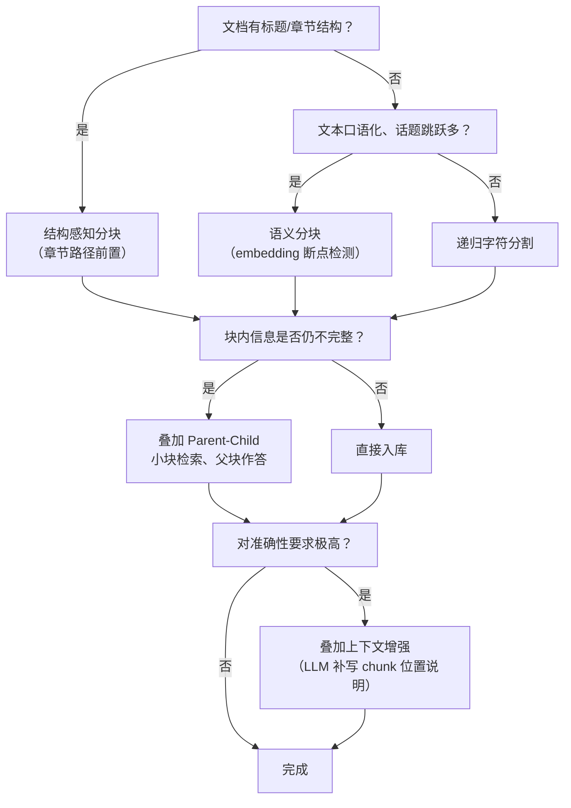

# RAG Chunk 分块方案选型指南

> 分块（Chunking）决定了"检索的最小语义单元"。切得太碎，答案散落在多个 chunk 里拼不回来；
> 切得太粗，无关内容稀释向量与 BM25 得分，召回噪声大。本文梳理市面主流分块方案的原理、
> 优缺点与适用场景，并说明本项目 rag-ingestion 的选型。

## 一、方案总览对比

| 方案 | 原理 | 优点 | 缺点 | 典型场景 |
| --- | --- | --- | --- | --- |
| 固定长度切分 | 按字符/token 数硬切 + overlap | 实现最简单；chunk 大小均匀可控 | 无视语义边界，句子被拦腰切断；召回后可读性差 | 兜底方案；无结构的纯文本流 |
| 递归字符分割 | 按分隔符层级（`\n\n`→`\n`→`。`→空格）依次尝试切分 | 尽量保留自然边界；参数少；通用性最强 | 对"标题-正文"层级无感知；表格仍可能被切 | 通用主力；配合结构感知可覆盖大多数文档 |
| 结构感知分块 | 按标题树/HTML 标签/段落层级切，chunk 前置章节路径 | chunk 自带上下文；短句不再无信息量；溯源精确（章节/页码） | 依赖文档有良好结构；标题层级解析错误会传导 | 制度文档、手册、报告、产品文档（企业知识库主力） |
| 语义分块 | 相邻句算 embedding 相似度，相似度骤降处断开 | 边界贴近语义变化点；对无结构口语化文本友好 | 每句都要调 embedding，索引成本高数倍；阈值难调 | 播客转写、聊天记录、无标题长文 |
| LLM 分块（命题切分） | LLM 把文档拆成自包含的原子命题（proposition） | 每条信息独立可检索；召回精度上限最高 | 成本极高（每文档一次 LLM 调用）；命题间关联丢失 | 法律条款、保险条款、高价值小语料 |
| Parent-Child（small-to-big） | 小块（~200 token）做检索，命中后返回父块（~1000 token）给 LLM | 召回精度与上下文完整性兼得；是目前生产环境效果最稳的方案之一 | 需要两级存储与 parentId 关联；索引量翻倍 | 问答型知识库；正文长且答案分散的场景 |
| 上下文增强（Contextual Retrieval） | 入库前让 LLM 为每个 chunk 生成"它在文中的位置说明"并拼到 chunk 头 | 显著缓解孤立 chunk 的歧义（"该标准"→"《差旅制度》第三章的住宿标准"）；Anthropic 实测召回失败率大幅下降 | 索引侧一次性 LLM 成本；需重嵌入 | 强准确性 RAG；chunk 普遍短小、代词/指代多 |
| Late Chunking | 先对全文长序列做 embedding，再按块池化出向量 | 每个 chunk 向量天然携带全文上下文；无需额外 LLM | 需要 long-context embedding 模型支持（如 jina-embeddings-v3）；ES 生态集成成本高 | 长文档 + 自建向量服务的高级方案 |

## 二、特殊格式的处理（表格 / 图片 / 代码）

| 内容类型 | 推荐做法 | 原因 |
| --- | --- | --- |
| 表格 | **整表一个 chunk，永不切碎**；表头/所在章节标题与表格一起入库；Markdown/HTML 表格化 | 报销标准、参数表被切碎后任何一路召回都拼不回完整语义；表头是列语义的唯一来源 |
| 图片 | OCR 提取文字，或视觉模型（VLM）生成结构化描述，与图注、所在段落绑定入库 | 流程图/架构图的信息只存在于像素里，不转文字则永远检索不到 |
| 代码 | 按函数/类边界切（AST 感知），保留文件路径与符号签名作为前置上下文 | 函数体被切断或缺失签名时，"这段代码是什么"无法回答 |
| 扫描件 PDF | 文本层为空时自动降级 OCR/视觉通道，禁止产出空 chunk | 空块入库会污染索引与统计 |

## 三、参数经验值

| 参数 | 推荐值 | 说明 |
| --- | --- | --- |
| chunk 大小 | 300~800 字符（约 150~400 token） | 问答类偏小、叙述类偏大；以"一个 chunk 能独立回答一个问题"为标准 |
| overlap | chunk 大小的 10%~15% | 防止边界处语义被切断；结构感知分块在自然边界处可少用 |
| 检索/返回分离 | 检索块 ≤ 父块 ≤ 上下文预算 | Parent-Child 方案的规模依据 |
| 表格上限 | 单表超长（>4000 字符）时按行分表并重复表头 | 兜底保护，避免极端大表撑爆上下文窗口 |

## 四、选型决策路径

> 实践中方案是**叠加使用**的：结构感知（或递归）打底 + 特殊格式保护是基线，
> Parent-Child 与上下文增强是强准确性场景的增量选项。

## 五、本项目（rag-ingestion）的选型与实现

| 决策点 | 本项目做法 | 代码位置 |
| --- | --- | --- |
| 打底方案 | 结构感知分块（标题树章节路径前置） | [StructureAwareChunker](file:///Users/zhoubyte/project/java/scorpio-java/scorpio-ai/scorpio-advanced-rag/rag-ingestion/src/main/java/com/zhoubyte/rag/ingestion/chunk/StructureAwareChunker.java) |
| 超长正文 | 段落贪心打包 + 滑动窗口切分（带 overlap，默认 500/50） | 同上 `splitText()` |
| 表格保护 | 整表一个 chunk + 章节路径前缀 + 超长截断保护（默认 6000 字符） | 同上 `chunk()` TABLE 分支 |
| 图片处理 | VLM 生成描述文字，独立成 chunk 并绑定章节路径 | [ImageParser](file:///Users/zhoubyte/project/java/scorpio-java/scorpio-ai/scorpio-advanced-rag/rag-ingestion/src/main/java/com/zhoubyte/rag/ingestion/parser/ImageParser.java) |
| 扫描件保护 | PDFBox 抽不到文本层直接报错，不产空块 | [PdfFallbackParser](file:///Users/zhoubyte/project/java/scorpio-java/scorpio-ai/scorpio-advanced-rag/rag-ingestion/src/main/java/com/zhoubyte/rag/ingestion/parser/PdfFallbackParser.java) |
| chunk 元数据 | blockType / sectionPath / page / position 全量入 ES，支持溯源与按类型过滤 | [IngestionService](file:///Users/zhoubyte/project/java/scorpio-java/scorpio-ai/scorpio-advanced-rag/rag-ingestion/src/main/java/com/zhoubyte/rag/ingestion/service/IngestionService.java) |

**后续可演进方向**（按投入产出比排序）：

1. Parent-Child 两级分块（索引侧改动中等，召回/回答收益最大）；
2. 上下文增强（每 chunk 一次 LLM 调用，适合语料量小但准确性要求高的库）；
3. 语义分块（仅当无结构文本占比显著时考虑，索引成本高）。
