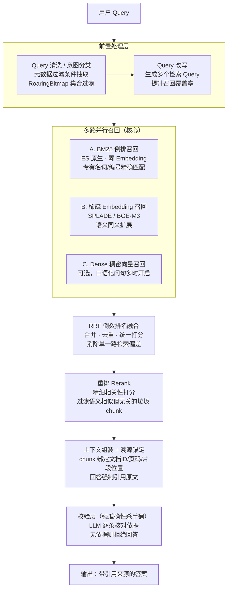

# 企业级高准确率 RAG 流水线设计

> 目标：在本地化部署条件下，构建一条"宁可不答、不给错答"的高准确率检索增强生成（RAG）流水线，
> 输出带引用来源、可溯源、可拦截幻觉的答案。

## 一、整体架构

## 二、各层详细设计

### 1. 前置处理层

| 步骤 | 内容 | 说明 |
| --- | --- | --- |
| Query 清洗 | 去口语冗余、修错别字、压缩空白 | 得到规范检索主 Query |
| 意图分类 | `RETRIEVAL`（需检索）/ `CHITCHAT`（寒暄/通用常识，无需检索） | 非检索意图直接短路，节省成本 |
| 元数据过滤 | 部门 / 密级 / 文档类型 / 时间 | 每个字段取值建一张 RoaringBitmap，查询时按条件做 **AND（跨字段）/ OR（同字段）** 位运算，得到允许命中的 docId 白名单，作为 ES `terms` 过滤下推到每一路召回 |
| Query 改写 | 由 LLM 生成多个同义/近义检索变体 | 单一提问覆盖不了文档作者的用词，改写后多路召回可显著提升覆盖率 |

### 2. 多路并行召回（核心）

| 通道 | 技术 | 强项 | 定位 |
| --- | --- | --- | --- |
| A. BM25 | ES 原生倒排 | 专有名词、编号、原文精确匹配 | 保证"硬信息"不漏，零 Embedding 成本 |
| B. 稀疏 Embedding | SPLADE / BGE-M3（`sparse_vector`） | 语义同义、字面不同的表达 | 弥补 BM25 字面匹配短板 |
| C. Dense 稠密向量 | 稠密 Embedding + kNN | 口语化、指代模糊的问句 | 可选，不强求，可后期开启 |

> 三路结果**并行执行、互不干扰**；各通道分数量纲不同，不直接可比，统一交给下一层融合。

### 3. RRF 倒数排名融合

- 公式：`score(d) = Σ 1 / (k + rank(d))`，`k` 常取 60；
- 只依赖各通道内部排名，天然免疫分数量纲差异；
- 同时完成多路、多改写 Query 结果的**合并与去重**，消除单一路检索的偏差。

### 4. 重排（Rerank）

- 召回分数 ≠ 相关性，"语义相似但答非所问"的垃圾 chunk 在这一层才暴露；
- 用重排模型（或 LLM 打分）对融合后的候选 chunk 逐条做精细相关性打分；
- 低于阈值的直接剔除，仅保留 Top-N 进入上下文——**对强准确性至关重要**。

### 5. 上下文组装 + 溯源锚定

- 每个进入 Prompt 的 chunk 绑定：**文档 ID、页码、片段位置**，并编号为 `[1] [2] …`；
- 生成阶段强制要求答案在论断后标注锚点编号（如 `[1]`）；
- 回答完成后解析锚点，还原出实际引用的原文片段，形成可溯源的引用列表。

### 6. 校验层（强准确性杀手锏，很多人漏掉）

由独立的低温 LLM 逐条核对生成答案：

1. 答案中每个论断是否都能在选中的 chunk 里找到**直接依据**（允许同义转述，不允许延伸推断）；
2. 禁止跨文档脑补、禁止推断原文没有的信息；
3. 校验不通过 → 直接返回兜底话术：**"资料不足，无法回答"**，宁可不答也不给不可信的答案。

### 7. 输出

带引用来源的答案：答案正文（含 `[n]` 引用锚点）+ 引用来源列表（文档 ID / 标题 / 页码 / 片段摘录）+ 全链路执行轨迹（便于观测与调优）。

## 三、落地说明（本项目实现）

| 设计项 | 本地化实现 |
| --- | --- |
| 检索引擎 | Elasticsearch 8.x 单节点（BM25 / `rank_features` / kNN 共用） |
| 模型 | 本地 Ollama：qwen2.5 做理解/生成/校验，nomic-embed-text 做稠密向量 |
| 稀疏通道近似 | 索引侧按 词频×IDF 生成加权词项存 `rank_features`；查询侧 LLM 同义扩展 + IDF 加权（预留 `SparseEncoder` 接口，后续可无缝替换为 BGE-M3 服务） |
| 中文分词 | 自研 CJK 2-gram 分词器，索引/查询两侧统一（无需 IK 插件） |
| Rerank | LLM 0~10 分打分 + 阈值过滤（可替换为 gte-rerank 等专业模型，接口不变） |
| 元数据过滤 | RoaringBitmap 位图 + Redis 持久化，结果作为 `terms` 过滤下推 ES |
| 可观测 | 每阶段耗时与摘要记录进 `PipelineTrace`，随答案一并返回 |
